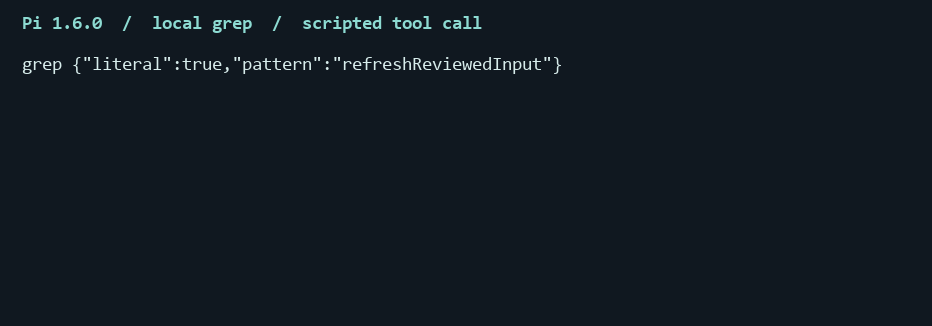
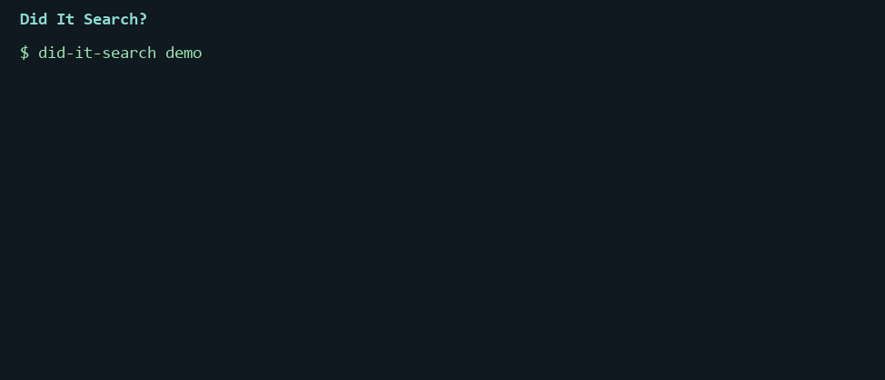

# Did It Search?

Find out why a repository search came back empty. Get a short explanation inside Pi, or use the standalone CLI to inspect skipped paths and verified ignore rules.

## Use it in Pi

Install the extension from the release tag, then start Pi with its built-in grep tool enabled:

```sh
pi install git:github.com/yyzquwu/did-it-search@v0.6.0
pi --tools +grep
```

The extension activates with Pi **1.5.1 and 1.6.0** and uses local ripgrep. In an open repository, try asking Pi: *“Use the grep tool with literal set to true to look for legacy_export.”*



Pi keeps its original result. An extra note can name a skipped path and the ignore rule that excluded it. Confirming a match in that file takes a separate search that you control. The extension can also flag a glob that selected zero files when it can distinguish that case from an ignored directory. A hit starts zero diagnostic processes.

For a plain miss, the extension skips examples such as `.env.local`, `node_modules/`, `.mypy_cache/`, and `target/` when choosing a path to show. A skipped filename is evidence about search scope. Its contents stay unread.

Diagnostics cover the stock local grep tool, a case-sensitive literal, default context and result limit, and a supported project-relative directory. Pi includes hidden files by default. The extension follows that scope and suppresses its note when it cannot verify a result within its time or output budget. Custom grep tools, shell commands and regex searches pass through. Installing the extension adds no Python dependency.

To remove it, run `pi remove git:github.com/yyzquwu/did-it-search@v0.6.0`.

### Reproduce the Pi example

From a checkout with Node 22.19+, Git and ripgrep, install the SDK in a scratch directory and run the offline comparison:

```sh
npm install --prefix ./node_modules/pi-test-host --ignore-scripts --no-audit --no-fund @earendil-works/pi-coding-agent@1.6.0
node tests/pi-integration.mjs --pi-root ./node_modules/pi-test-host --demo
```

The test scripts the model's tool call and runs Pi's actual grep and extension machinery with the extension off and on. No model key is needed. Replace `--demo` with `--bench` for timings on fixtures with 100 and 10,000 ignored dependency files. Use `--audit-reads` separately to verify ignored contents stay unread (Windows file permissions or Linux with `strace`).

On one Windows run of the [v0.6 prototype](https://github.com/yyzquwu/did-it-search/commit/c715666aca25d6910418ea1d6814e0d893318b29) with Pi 1.6.0, Node 22.19.0 and ripgrep 15.2.0, the median miss took 808 ms with the extension off and 1,090 ms with it on (100 ignored files). With 10,000 ignored files the medians were 640 ms and 1,318 ms. Each figure comes from 12 alternating measurements per variant after three warmups and includes native grep. Hit timings varied substantially on this host.

## Try the ignored-caller demo

With [ripgrep](https://github.com/BurntSushi/ripgrep#installation), Git, and `uvx` installed, run this from any directory:

```sh
uvx did-it-search demo
```

The demo creates a temporary Git repository where the only caller of `legacy_export` is in `generated/client.ts`. It runs a search that misses the caller, shows the file and its ignore rule, then runs the suggested command on the demo file so you can see the call.



## Explain a search in your own repository

```sh
uvx did-it-search explain load_settings . --glob '*.py'
```

For a persistent CLI installation, use Python 3.11+:

```sh
python -m pip install did-it-search==0.6.0
```

From the root of this checkout, try the same search twice:

```sh
did-it-search explain createGrepTool src/diditsearch --glob '*.rs'
rg -n -F -- createGrepTool src/diditsearch
```

The first command exits 1 because the glob selects zero files. The second finds `createGrepTool` in `pi_adapter.mjs`. To try your own search, replace the literal and directory. Add `--json` for a machine-readable result.

`explain` needs only Python and ripgrep after installation. It runs locally with a five-second budget by default. Use `--timeout 15` to allow more time. Exit 0 means a confirmed match. Exit 1 means the search completed with no match or selected zero files. Exit 2 means coverage was partial, the path was missing, or the command encountered an error. In JSON, `files_searched` is null when the count is unknown. A suggested follow-up runs only if you choose to execute it.

The report shows up to three representative skipped paths. A directory entry can represent many files. In JSON, `skipped_paths` carries these examples and `follow_up_argv` holds the optional command as an argument list. A true `coverage_complete` means the tool finished accounting for the requested scope. A `partial` result can still have complete accounting when all exclusions are known.

Rule details come from Git for ordinary repository `.gitignore` entries. If Git is unavailable or competing ignore sources make attribution uncertain, the path can still appear with a null `rule`. A named skipped file is a place to check. The optional follow-up is what determines whether the literal is there.

Directory globs are relative to the directory you pass. The command checks ignore rules even for an explicitly named file or a positive glob. It can count excluded paths by name and leaves their contents unread. Counts include eligible empty files. Binary files are identified by NUL bytes after ripgrep decodes the input. A confirmed text match can coexist with exclusions.

Ripgrep normally skips hidden entries during a directory search. To inspect a hidden directory such as `.github/workflows`, name it directly. Printed follow-ups use PowerShell on Windows and shell quoting on Unix. Use the JSON argument list for programmatic execution.

Large generated trees can exhaust the 4 MiB ripgrep output budget while the command counts excluded filenames. A confirmed match is still reported if exclusion counting stops early. For an output or process limit, narrow the path to the source directory you want to check. `--timeout` changes the time budget only.

## Catch search regressions in CI

The GitHub Action checks the Pi SDK installed in your project against a reviewed baseline. In the example PR, downgrading Pi from 1.5.1 to 1.5.0 lost the match in `migrations/main/a.js`. The Action reported that regression and kept three previously accepted differences quiet. [Example pull request](https://github.com/yyzquwu/did-it-search/pull/1)

From a project with a local installation of `@earendil-works/pi-coding-agent`, install the kit and record today's behavior. Use Python 3.11+, Git, ripgrep on PATH, and Node 22.19+ (Node 24 recommended).

```sh
python -m pip install "git+https://github.com/yyzquwu/did-it-search.git@v0.6.0"
did-it-search baseline --tool pi
did-it-search compare --tool pi
```

**First adoption takes two PRs.** In the first, review and merge `.did-it-search.json` into the target branch. It records the installed package version, a fingerprint of the eight fixtures, and the outcomes you accept. In the next PR, add the workflow step. If the base branch has no baseline yet, the check exits 2 even when the PR itself adds one.

In a pull-request workflow with `contents: read`, set up Node and ripgrep and include these steps:

```yaml
- uses: actions/checkout@v7
  with:
    fetch-depth: 0
    persist-credentials: false
- run: npm ci
- uses: yyzquwu/did-it-search@v0.6.0
```

On a PR the Action compares the candidate's installed SDK with the baseline from the PR's base commit. A contributor can inspect the package versions, request, expected result and native tool response in the job summary. New regressions and changed failures exit 1. Improvements and known failures pass. An incompatible baseline or a tool that couldn't run exits 2. Use `compare --json` to consume the comparison outside GitHub. The existing `check` command still grades absolute conformance.

**Updating the baseline.** To accept a deliberate change, run `baseline --replace` with the proposed SDK installed and review the JSON diff. Merge just the approved baseline first, then run the dependency PR against it. Replacing the baseline in the dependency PR itself leaves that check comparing against the old expectations. If you use a required check, the two-PR sequence lets reviewers approve the new expectation without disabling it.

Baseline and comparison evidence displays temporary fixture roots as `<fixture>`. When the package lives in a subdirectory, set both `project-dir: web` and `baseline: web/.did-it-search.json` (substitute your directory). Use checkout at the workspace root. Events other than `pull_request`, including `merge_group`, use the checked-out baseline.

## Replay the Pi fix


Install Git, ripgrep (`rg`), and Node.js 22.19+ (tested with Node 24). With `uvx` available, run:

```sh
uvx --from git+https://github.com/yyzquwu/did-it-search.git@v0.6.0 did-it-search replay pi
```

The replay runs Pi's grep implementation from both sides of [the merged fix](https://github.com/earendil-works/pi/pull/11895) on two fixtures. Both requests ask for the literal `hello` under `repo` with the glob `migrations/main/*.js`. One fixture has the match at `repo/migrations/main/a.js`. The other puts the only match under `repo/nested/migrations/main/b.js`, outside the requested glob. That second case catches a fix that simply widens the search. Add `--json` to inspect the results.

### Observed result

The pinned replay needs network access to GitHub and the npm registry. It checks the two commit IDs and the downloaded package hashes, loads the upstream code in a temporary directory, and runs without a model or API key. Exit 0 means the historical regression was reproduced, 1 means the behavior differed from the expected transition, and 2 means the replay could not be evaluated.

| Pinned Pi revision | Target in `migrations/main` | Only the deeper decoy contains `hello` |
| --- | --- | --- |
| Before · `1f7c685` | `No matches found` | `No matches found` |
| After · `6bf2ab9` | `migrations/main/a.js:1: console.log("hello");` | `No matches found` |

The [recorded replay](study/pi-11895.json) contains the grades and native responses. Did It Search? v0.1 also missed the target. The reference adapter now evaluates directory globs relative to the requested search directory.

### Grade your local Pi installation

The local check loads `@earendil-works/pi-coding-agent` from the calling project's Node dependencies. On the target-file case, published versions 1.4.0 and 1.5.0 missed the match; 1.5.1 and 1.6.0 found it. From the project containing Pi, run:

```sh
did-it-search check --tool pi --case glob-root-hit --case glob-root-decoy --json
```

Remove the two `--case` options to grade all eight cases. The JSON report retains Pi's native response when it fits alongside the diagnostic in the adapter's 64 KiB output limit. A generic empty result can pass the decoy and still fail a case that requires a specific exclusion reason.

## Run the conformance fixtures

```sh
did-it-search check
did-it-search check --json --adapter examples/plain_rg.py
did-it-search fixtures search-fixtures
```

The reference passes all eight cases. The example wraps ordinary ripgrep output and handles a missing path. It passes four cases and exits 1. Try `did-it-search check --adapter examples/reference_adapter.py` for a passing external adapter. The last command above writes eight repositories and `cases.json` to a new directory so you can open a case in your own agent. Run the installed CLI as `python -m diditsearch` when preferred.

| Fixture | Search truth | Expected status | Exclusions |
| --- | --- | --- | --- |
| hit | A text file contains the literal | `matched` | none |
| miss | A text file was searched and the literal is absent | `no_match` | none |
| missing-path | The requested path does not exist | `missing_path` | none |
| empty-glob | The project contains Python and the request selects Rust files | `no_files` | none |
| ignored-caller | The only call is in a generated file excluded by Git ignore rules | `partial` | `ignored` |
| binary | The only occurrence is in a file containing NUL bytes | `partial` | `binary` |
| glob-root-hit | The match lies inside the requested directory and matches its folder glob | `matched` | none |
| glob-root-decoy | Only a lookalike folder outside the glob contains the literal | `no_match` | none |

## Check your search adapter in CI

Implement the [adapter protocol](#adapter-protocol) around your tool's actual search output. Run this step after installing the kit in your CI environment:

```yaml
- name: Check search diagnostics
  run: did-it-search check --json --adapter ci/search_adapter.py
```

Exit 0 means every case agreed with its answer key. Exit 1 means at least one answer disagreed. Exit 2 means the kit or adapter could not run a check, including malformed responses and timeouts. The runner continues after an adapter error and includes the other results. The fixture names and answer key are public, so this is a regression suite for maintainers.

### Adapter protocol

The runner starts a new process in each fixture's root and sends one UTF-8 JSON object followed by a newline on stdin.

```json
{"pattern":"legacy_export","path":".","glob":null}
```

Return one UTF-8 JSON object without a byte-order mark on stdout (up to 64 KiB) and exit 0 when your tool can describe the outcome. Diagnostic logs may go to stderr. If your adapter keeps a fixture open and cleanup fails, the runner preserves the report and its exit status. Stderr identifies the temporary directory for later removal.

```json
{"status":"partial","detail":"An ignored file was outside the text search.","skipped":["ignored"]}
```

`pattern` is a case-sensitive literal. `path` is relative to the fixture root. `glob` is an optional ripgrep-style file glob. The kit grades the status and the set of exclusion reasons. Omit `skipped` for an empty set. The human-readable `detail` string is included in the report. An adapter that cannot determine a cause should report its own result honestly so a mismatch remains visible.

Put `--adapter` last: everything after it is the adapter command. A first argument ending in `.py` is resolved relative to the calling directory and run with the kit's Python. Other executables may be given by path or name on PATH. Additional arguments are passed unchanged, so use absolute paths for any other files your command needs. Use `--timeout 5` before `--adapter` to set a per-process timeout in seconds.

## What happened with real agents?

In a three-project pilot, each of three agents got the same initial result for three different situations. All three investigated and answered correctly. The [pilot](study/README.md) includes the prompts, first search outputs, follow-ups and final answers. You can recreate its project directories locally.

## Reference scope

The reference searches small, stable fixtures. It includes dotfiles and skips Git metadata and links. It applies the glob and in-tree ignore rules even to explicitly named files. Native ripgrep can search a named file that these rules exclude. The reference enumerates filenames under ignored directories to account for exclusions. It reads up to 1 MiB plus one byte per eligible file to identify binary or oversized inputs. A UTF-16 file containing NUL bytes is classified as binary, even though native ripgrep can decode a UTF-16 BOM. A confirmed hit takes precedence and still reports exclusions.

Run the tests from an installed checkout with `python -m unittest discover -s tests`.
